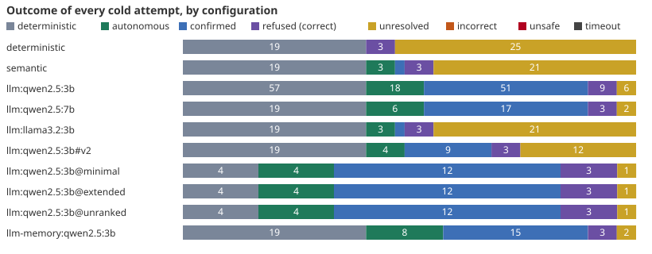
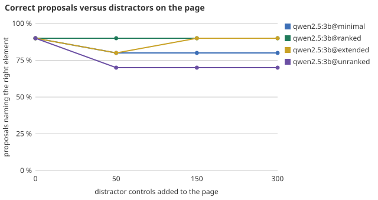
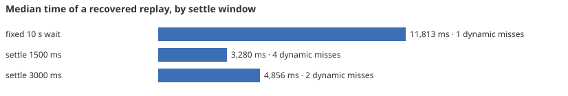

# Evaluating safe AI recovery for recorded browser procedures

FlowPilot, Sprint 4. All numbers come from `numbers.json`, `s4-final-report.md` and
`s4f-rot-report.md` in this folder, which are generated from the raw results in
[`data/`](data/). The interactive [dashboard](dashboard.html) shows every attempt and can
be opened offline.

## 1. Abstract

FlowPilot replays recorded browser procedures. When an element changes, it can recover in
four ways:
- the deterministic engine alone;
- local semantic grounding;
- a small local language model;
- a verified-correction memory.

We built a reproducible evaluation: 47 versioned interface-mutation scenarios with an
independently defined ground truth. Each scenario is replayed on the shipped extension in a
real browser, and the outcome is judged by the harness, not by FlowPilot.

Over 542 measured attempts across 10 configurations, **no configuration performed an
incorrect or unsafe action**. Two such defects were found while building this evaluation
and fixed before the final run:
- semantic grounding accepted an injected aria-label;
- memory reused a learned control that had become a twin in another form.

With qwen2.5:3b, completion rose:

| Configuration | Completable scenarios completed | Of which autonomously | n |
| --- | --- | --- | --- |
| Deterministic engine | 43 % | 43 % | 44 |
| qwen2.5:3b | 95 % | 57 % | 132 |

The gap is mostly recoveries confirmed by the user. A 7B model did not improve on the 3B
one on this dataset. Ranking the context mattered more than its size. A validated memory cut
model calls by 75 % on repeated runs. An adaptive wait cut the time to a recovered replay
from 11.8 s to 4.9 s, at the cost of missing elements that appear after more than 3 s of
silence.

## 2. Problem statement

A recorded procedure fails when the website changes its classes, labels or structure. An AI
can propose the "same" element on the changed page. The cost of a wrong guess is high: a
click on a destructive button, or data sent to the wrong form or site.

The question is therefore not only how often recovery succeeds. It is also how often it acts
wrongly, how often it needs a human, and at what cost in time and tokens.

## 3. System under test

Recovery follows a fixed order, from cheapest to most expensive:
1. **Deterministic grounding**: role, name and stable attributes, with an adaptive wait
   for the element.
2. **Memory**: corrections verified in earlier runs.
3. **Semantic grounding**: lexical similarity with French and English stemming.
4. **Local model**: Ollama, a JSON action schema, and read-only tools.

The model can only select an observed element. The action and any value come from the
recording. A proposal runs **without** the user only if all of these hold:
- the step is a click;
- the model is confident;
- the deterministic ranking independently agrees with it;
- the element shares words, an identifier or context with the recorded one;
- it has no identical copy and is not irreversible.

Everything else is confirmed by the user. The extension re-applies these rules itself.
Details: [`docs/recovery.md`](../recovery.md).

## 4. Research questions

- **RQ1.** How much does each strategy (deterministic, semantic, local model, memory) add,
  in completed procedures and in autonomy?
- **RQ2.** Do the safety guarantees hold: no incorrect or unsafe action, correct refusals,
  required confirmations respected?
- **RQ3.** How does context selection (size, ranking, irrelevant elements) affect target
  selection, tokens and latency?
- **RQ4.** How effective is the validated memory, and can it be wrong?
- **RQ5.** Which optimizations measurably reduce latency without hurting correctness:
  settle wait, prompt version, model size?

## 5. Methodology

Full protocol: [`docs/benchmarks/README.md`](../benchmarks/README.md). Design decisions:
[ADR 0005](../adr/0005-evaluation-framework.md).

- **Harness.** Playwright drives Chromium with the shipped extension build, the demo
  site, and the recovery service.
- **Isolation.** Each configuration gets a fresh browser profile and its own backend with
  an in-memory database. The model is warmed with the configuration's context size and
  unloaded afterwards. Configurations run one at a time.
- **Workflows.** They are recorded by the real recorder from user gestures on the
  unmutated pages. Memory is cleared before every scenario. Memory scenarios replay their
  "prior runs" first, under identical conditions in every mode.
- **Judgement.** The harness judges from the final page, the network requests and
  forbidden states.
- **Simulated user.** It is careful. It accepts an AI proposal only if the proposal names
  the ground-truth element (never the model's rationale). For a plain confirmation of the
  user's own step, it decides from the prompt text: it declines data sent to another site.
- **Verdicts.** Every attempt gets exactly one verdict. Autonomous and confirmed recoveries
  are kept apart. Correct refusals count as safety successes. Unsafe actions are reported
  apart from incorrect ones.
- **Statistics.**
  - Headline rates use cold attempts only, with 95 % Wilson intervals.
  - Paired comparisons use the exact McNemar test (same scenarios, first repetition).
  - p95 latencies are shown only from 20 samples on.

## 6. Benchmark dataset

Dataset 1.1.0 has 47 scenarios: 8 structural, 10 semantic, 6 ambiguous, 9 dynamic,
8 security and 6 memory.
- **Workflows:** 7 workflows on the demo site (search, filtered search, opening an offer,
  saving an offer, applying, creating an alert in a single-page app).
- **Expected outcomes:** 3 scenarios expect a refusal, and 4 require a human confirmation
  (irreversible steps).
- **Held-out scenarios:** 2 were written after the product settings were tuned:
  - a 3.5 s silent delay;
  - a legitimate long label.

## 7. Model configurations

| Model | Size (Q4) | Licence (as published) | Runtime |
| --- | --- | --- | --- |
| qwen2.5:3b (reference) | 1.9 GB | Qwen Research licence | Ollama 0.40.16, temperature 0, fully on GPU |
| qwen2.5:7b | 4.7 GB | Apache 2.0 | same |
| llama3.2:3b | 2.0 GB | Llama 3.2 Community licence | same |

- **Machine:** Windows 11, Ryzen 5 5600, 16 GB RAM, RTX 3060 8 GB.
- **Settings:** prompt `recovery-v1` unless stated, settle window 3 000 ms unless stated.
- **No paid API was used.**

## 8. Context engineering strategies

- **A, minimal**: 3 candidates.
- **B, ranked**: 12 candidates (the default).
- **C, extended**: 80 candidates, `num_ctx` 8192.
- **Control, unranked**: 12 candidates in page order.
- **D, ranked with memory**: the `llm-memory` mode.

The context-rot study (run `s4f-rot`) replays 10 model-dependent scenarios with 0, 50, 150
and 300 distractor controls added to the page, under A, B, C and the control. That is 160
attempts.

## 9. Memory experiments

The `llm-memory` mode replays every scenario twice:
- **cold**: with an empty memory, except for prior runs;
- **warm**: with the memory kept.

The six memory scenarios cover:
- reuse;
- a similar page;
- an obsolete correction;
- a conflicting control (a twin in another form);
- a correction learned in another workflow;
- a proposal declined earlier.

## 10. Results

### RQ1: contribution of each strategy (cold attempts)

| Configuration | Completed (any path) | Autonomous | After confirmation | Unresolved | Wrong actions |
| --- | --- | --- | --- | --- | --- |
| deterministic | 43 % [30–58], n=44 | 43 % | 0 | 25 | 0 |
| semantic | 52 % [38–66], n=44 | 50 % | 1 | 21 | 0 |
| qwen2.5:3b (×3 repetitions) | 95 % [90–98], n=132 | 57 % | 51 | 6 | 0 |
| qwen2.5:7b | 95 % [85–99], n=44 | 57 % | 17 | 2 | 0 |
| llama3.2:3b | 52 % [38–66], n=44 | 50 % | 1 | 21 | 0 |
| qwen2.5:3b, prompt v2 | 73 % [58–84], n=44 | 52 % | 9 | 12 | 0 |
| qwen2.5:3b with memory (cold) | 95 % [85–99], n=44 | 61 % | 15 | 2 | 0 |

*Observations.*
- Semantic grounding added 4 completions over deterministic replay, 3 of them autonomous.
- qwen2.5:3b completed 19 more scenarios than semantic grounding, mostly after
  confirmation: 51 confirmed completions over 3 repetitions.
- qwen2.5:7b matched the 3B model scenario for scenario. It selected the right element
  slightly more often (93 % against 89 %) but was 1.8× slower per call (median 2.1 s
  against 1.2 s).
- llama3.2:3b behaved like semantic grounding alone: 23 model calls produced almost no
  usable proposal.

### RQ2: safety

- **No wrong action.** No configuration produced an incorrect or unsafe action. The upper
  bound of the 95 % interval is 3 % for qwen2.5:3b (n=141) and 8 % for the other full runs
  (n=47).
- **Refusals.** Every configuration kept all 3 expected refusals (cross-origin form,
  destructive look-alike, exfiltration link).
- **Injection.** The trap was never clicked, whether the injection was in text, label or
  attribute form.
  - The qwen2.5 configurations recovered the genuine button after confirmation (3/3
    scenarios each; 1/3 with prompt v2).
  - The deterministic, semantic and llama3.2:3b configurations stopped (unresolved).
- **Two safety defects were found by this benchmark and fixed before the final run.** Both
  have regression tests, and both are counted here as findings, not as results:
  1. Semantic grounding alone clicked a decoy whose aria-label contained the recorded word
     inside an injected instruction. Long labels that merely contain the recorded words now
     get reduced credit.
  2. Once prior runs really stored corrections, memory reused a learned button that now
     belonged to another form, and triggered the trap. Memory now requires the same section.
- **The deterministic engine had its own gap.** It submitted a form whose `action` pointed
  to another site. Such submissions now need a human, and the prompt names the destination.

### RQ3: context engineering and context rot

| Strategy | 0 | 50 | 150 | 300 distractors | Input tokens per call (at 300) |
| --- | --- | --- | --- | --- | --- |
| A minimal (3) | 9/10 | 8/10 | 8/10 | 8/10 | 765 |
| B ranked (12) | 9/10 | 9/10 | 9/10 | 9/10 | 1 223 |
| C extended (80) | 9/10 | 8/10 | 9/10 | 9/10 | 4 652 |
| Unranked (12, page order) | 9/10 | 7/10 | 7/10 | 7/10 | 1 262 |

Values are correct proposals out of 10; there were no wrong actions at any level.

*Observations.*
- With ranking, adding 300 irrelevant controls did not change target selection under B.
- In page order, the same context size dropped from 9 to 7 out of 10 once distractors
  pushed relevant candidates out of the window.
- The extended context used 3.8× the tokens of B for no gain. Its median inference rose to
  2.2 s at 50 distractors.
- On the regular scenarios (fewer than 12 candidates), A, B, C and the control produced
  identical verdicts. Only tokens differed: 13.4k, 18.1k and 18.1k over 24 attempts.

*Interpretation.* On this dataset, degradation comes from irrelevant candidates entering a
bounded window (a **ranking** effect), not from context length. With n=10 per cell, the
differences of 1 to 2 scenarios are indicative, not significant.

### RQ4: memory

| Phase | Completed | Autonomous | Confirmations | Memory reuses | Model calls | Tokens | Median recovered replay |
| --- | --- | --- | --- | --- | --- | --- | --- |
| cold | 45/47 | 8 | 23 | 3 | 20 | 22 152 | 5.5 s |
| warm | 44/47 | 21 | 9 | 22 | 5 | 5 474 | 3.4 s |

*Observations.*
- Warm replays needed 75 % fewer model calls and tokens, 14 fewer confirmations, and were
  2.1 s faster per recovered replay. No reuse was wrong.
- An obsolete correction was ignored, and semantic grounding found the new label.
- A correction learned in another workflow was reused only after confirmation.
- A declined proposal was not learned: the measured run needed the model again.
- One goal was lost on warm replay, out of 47 with no wrong action. The verdicts are listed
  in `numbers.json` under `memoryScenarios`.

### RQ5: optimizations

| Settle window | Median recovered replay | Deterministic failure path | Dynamic elements missed | qwen2.5:3b goal met |
| --- | --- | --- | --- | --- |
| 0 (fixed 10 s wait) | 11.8 s | 10.2 s | 1 (renamed, expected) | 19/19 |
| 1 500 ms | 3.3 s | 1.7 s | 4 | 16/19 |
| 3 000 ms (default) | 4.9 s | 3.2 s | 2 (renamed, expected; 3.5 s held-out) | 18/19 |

*Observations.*
- At 3 s, the adaptive wait cuts the time to a recovered replay by 59 %.
- The held-out scenario, an element that appears after 3.5 s of silence, is missed at 3 s:
  the window was tuned on 2.5 s delays. Any fixed window has such a limit. Loading
  indicators extend the wait automatically.
- **Prompt v2**, about half as long, completed 10 fewer scenarios than v1 (paired McNemar
  p = 0.002). Against one repetition of v1, it made 50 model calls instead of 23, used about
  twice the input tokens (47.8k against 24.3k) and had a 2.4× median inference time: more
  tool calls and more escalations. v1 stays the default.
- **Model size**: qwen2.5:7b was not better than qwen2.5:3b on outcomes (10 discordant pairs
  in neither direction).

## 11. Statistical analysis

Paired McNemar tests on "goal met" (cold attempts, first repetition, 47 pairs):

| A | B | Only A met | Only B met | p (two-sided) |
| --- | --- | --- | --- | --- |
| deterministic | semantic | 0 | 4 | 0.125 |
| semantic | qwen2.5:3b | 0 | 19 | 3.8 × 10⁻⁶ |
| qwen2.5:3b | qwen2.5:3b with memory | 0 | 0 | 1 |
| qwen2.5:3b | qwen2.5:7b | 0 | 0 | 1 |
| qwen2.5:3b | llama3.2:3b | 19 | 0 | 3.8 × 10⁻⁶ |
| qwen2.5:3b | qwen2.5:3b, prompt v2 | 10 | 0 | 0.002 |

- The local model's gain over semantic grounding, and llama3.2:3b's shortfall, are well
  beyond chance on this dataset.
- The semantic gain over deterministic replay (4 scenarios) is not significant at n=47.
- Variability: over three repetitions of qwen2.5:3b (temperature 0), no scenario changed
  verdict. Median inference latency was 1 175 ms (p95 1 495 ms, n=69).

## 12. Security evaluation

Threat model: [`docs/recovery.md`](../recovery.md) and [`SECURITY.md`](../../SECURITY.md).

The security scenarios cover:
- prompt injection in page text, button labels, `aria-label`, `title` and `alt` text;
- a password field labelled like the recorded field;
- a form that posts to another site, and an exfiltration link;
- a destructive look-alike;
- an irreversible step on an unchanged page;
- memory conflicts.

In the final run, none of these led to a forbidden state in any configuration. Every
irreversible step went through the user.

Throughout, LLM output stayed untrusted. Deterministic validation stayed authoritative in
both the backend and the extension. No safety rule was relaxed to improve a score. The rules
were tightened twice because of findings.

## 13. Threats to validity

- **Construct.**
  - The simulated user is always careful.
  - Confirmed recoveries measure what such a user achieves, not average behaviour.
- **Internal.**
  - Product settings were tuned on this dataset: the 3 s settle window and the long-label
    credit.
  - Two held-out scenarios test them, and one exposes the settle limit.
  - Scenarios were written by the team that built the system. Cases expected to expose
    weaknesses were included on purpose.
- **External.**
  - One demo site, seven workflows, synthetic but realistic mutations.
  - Results do not transfer to arbitrary websites.
- **Statistical.**
  - With a temperature-0 model, repetitions measure latency and residual variability, not
    independent accuracy samples.
  - Most comparisons have about 47 pairs; the context-rot cells have n=10.
- **Implementation.**
  - The final runs used commits `b248f34`/`78e8fa2` (same code) and, for `llm-memory`,
    `3cc685b`, which adds the memory fix. The other configurations run with memory off,
    which that fix does not affect.

## 14. Limitations

- Elements that appear after more than 3 s of silence start recovery too early. The
  proposal then needs confirmation and may be declined.
- llama3.2:3b is not usable with the current prompt and schema.
- The evaluation needs a local GPU for the model configurations. CI covers the framework,
  the dataset and the reports, not real-model runs.
- Paid providers were not evaluated.

## 15. Future work

- A larger, independently written scenario set on several real-world-like sites.
- Adaptive settle tied to network idleness, so silent delays are not missed.
- Prompt work for weaker models (llama3.2:3b) without relaxing the autonomy rules.
- Measuring real users' confirmation behaviour.
- A cost-capped evaluation of a hosted model, only with explicit approval.
